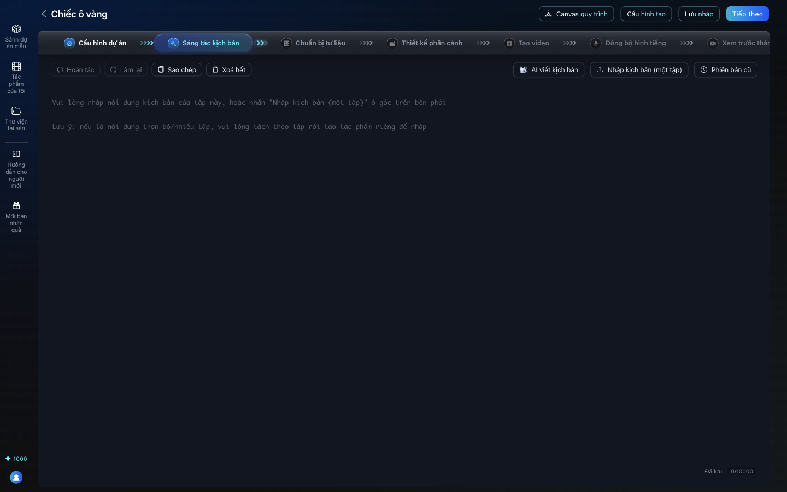

# Bài 00. Giới thiệu: làm phim AI mà nhân vật không "đổi mặt"

**Mục tiêu:** người xem hiểu sẽ làm ra cái gì, theo những bước nào, và vì sao giữ nhân vật nhất quán
là phần khó nhất của phim AI.

**Thời lượng gợi ý:** 3 phút.

## Cảnh quay 1. Mở đầu bằng phim thành phẩm

**Lời dẫn:**
> Đây là "Chiếc ô vàng", một phim ngắn 30 giây làm bằng các công cụ miễn phí, phần vẽ do AI đảm nhận,
> không tốn đồng nào. Hãy để ý
> cô gái tên Mai và ông Tư bán bánh mì: từ cảnh đầu tới cảnh cuối, khuôn mặt, kiểu tóc, chiếc áo len,
> chiếc nón lá đều giữ nguyên. Đó chính là thứ khó nhất khi làm phim bằng AI, và cũng là thứ bạn sẽ
> học được trong loạt video này.

**Thao tác:** phát `assets/film/chiec-o-vang.mp4` toàn màn hình.

## Cảnh quay 2. Vì sao nhân vật hay bị "đổi mặt"

**Lời dẫn:**
> Mỗi lần bạn bảo AI vẽ, nó vẽ lại từ đầu. Chỉ cần mô tả hơi khác, hoặc thậm chí mô tả y hệt, cô gái
> trong cảnh sau có thể dài tóc hơn, mặc áo khác màu. Bí quyết là: vẽ nhân vật một lần thật kỹ, rồi
> mọi cảnh sau đều dùng chính hình đó làm mẫu. Ở ví dụ này, cùng một yêu cầu nhưng lần thứ hai AI
> vẽ tóc Mai dài quá vai và vết ướt thành màu bùn. Ta sẽ học cách phát hiện và sửa lỗi này.

**Thao tác:** hiện ảnh `assets/screens/30-nhat-quan-goc-lech-sua.png` (trái: bản gốc, giữa: bị lệch,
phải: đã sửa).

## Cảnh quay 3. Bảy bước làm phim trong AID Studio

**Lời dẫn:**
> AID Studio là phần mềm mã nguồn mở để làm phim AI và truyện tranh động. Mọi dự án đi qua bảy bước,
> hiện ngay trên thanh trên cùng: Cấu hình dự án, Sáng tác kịch bản, Chuẩn bị tư liệu, Thiết kế phân
> cảnh, Tạo video, Đồng bộ hình tiếng, và Xem trước thành phẩm. AID giữ mọi thứ của một phim ở một
> chỗ: kịch bản, nhân vật, bối cảnh, từng cảnh quay, rồi ghép thành phim.

**Thao tác:** mở một dự án, rê chuột lần lượt qua bảy bước trên thanh bước.

## Cảnh quay 4. Làm hoàn toàn miễn phí như thế nào

**Lời dẫn:**
> Các phần tạo ảnh và video bằng AI ngay trong AID cần trả phí cho nhà cung cấp. Trong loạt video
> này, mình chỉ dùng những thứ miễn phí: AI của Google Gemini bản miễn phí để AID hiểu kịch bản; ứng
> dụng Gemini để vẽ nhân vật và cảnh; còn chuyển động máy quay, giọng nói và phụ đề thì làm ngay trên
> máy tính. Kết quả là một phim hoàn chỉnh như bạn vừa xem.

**Thao tác:** hiện bảng "Chi phí: 0 đồng" trong `README.md`.

## Cảnh quay 5. Cần chuẩn bị gì

**Lời dẫn:**
> Bạn cần: một tài khoản AID Studio (người quản trị sẽ tạo cho bạn, hoặc bạn tự cài theo bài 01), một
> tài khoản Google để dùng ứng dụng Gemini, và một máy tính. Nếu muốn tự tạo video chuyển động và
> phụ đề, máy cần có FFmpeg. Bắt đầu thôi.
