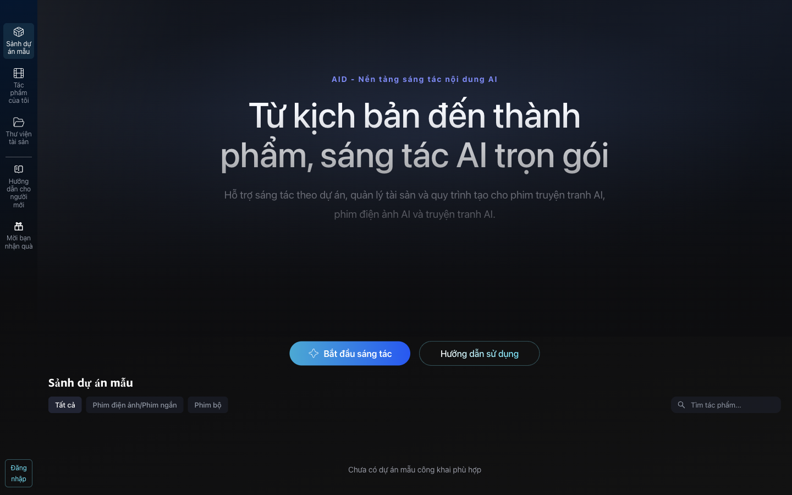
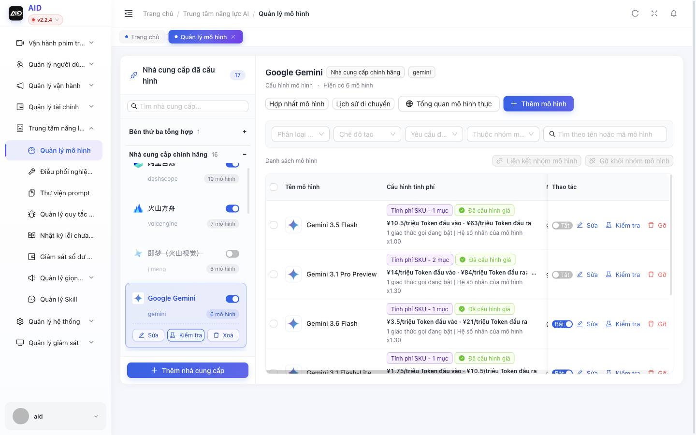
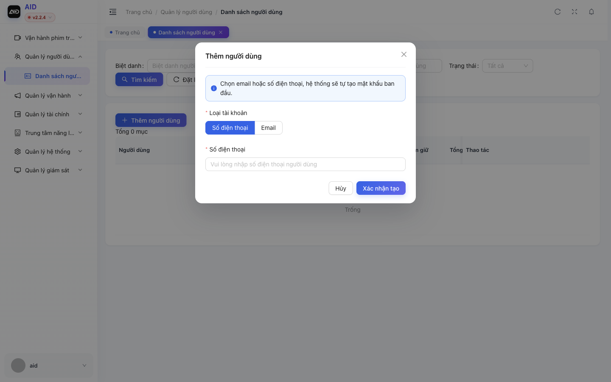

# Bài 01. (Cho người quản trị) Chạy AID, bật Gemini miễn phí, tạo tài khoản

**Mục tiêu:** có một AID Studio tiếng Việt chạy được, chỉ dùng model miễn phí, và một tài khoản cho
người làm phim.

**Ai cần xem:** người tự cài AID. Nếu đã có sẵn tài khoản trên một AID do người khác quản trị, bỏ qua
bài này.

**Thời lượng gợi ý:** 8 phút.

## Cảnh quay 1. Chạy AID trên máy

**Lời dẫn:**
> Trên máy Mac, AID chạy bằng Docker cho cơ sở dữ liệu, cộng với backend Java và giao diện web.
> Mình đã gom các lệnh vào thư mục `vi/local`. Làm theo đúng thứ tự trong file README ở đó.

**Thao tác:** mở terminal, chạy lần lượt các lệnh trong mục "Chạy lần đầu" của `vi/local/README.md`.
Backend chạy ở cửa sổ terminal đó (không trả lại dấu nhắc); mở một terminal thứ hai cho các lệnh sau.
Backend sẵn sàng khi `curl -s -o /dev/null -w '%{http_code}' localhost:8080/auth/public-config` trả về
`200` (trong log có dòng "Started AidApplication"). Mở http://localhost:3000.

## Cảnh quay 2. Tạo API key Gemini miễn phí

**Lời dẫn:**
> AID cần một "bộ não" để hiểu kịch bản. Mình dùng Gemini của Google bản miễn phí. Điều quan trọng
> nhất: tạo key trong một **project mới, chưa gắn thẻ thanh toán**. Project như vậy không thể bị tính
> tiền; khi dùng hết lượt miễn phí trong ngày, nó chỉ báo lỗi chứ không trừ tiền.

**Thao tác:**

(Tên nút theo giao diện Google AI Studio ngày quay; Google có thể đổi. Điều bắt buộc: key nằm trong một
project không gắn tài khoản thanh toán, danh sách ghi "Free tier".)

1. Mở https://aistudio.google.com/apikey, đăng nhập Google.
2. Bấm **Create API key**. Ô "Name your key": gõ `AID Studio Tutorial`.
3. Ở ô chọn project, chọn **Create project**, đặt tên `AID Tutorial`, bấm **Create project**.
4. Bấm **Create key**. Sao chép key (bấm biểu tượng copy). Không chia sẻ key cho ai.
5. Ở danh sách key, kiểm tra cột tier của project mới ghi **Free tier**. Nếu ghi "Paid", xóa key đó.

**Lưu ý khi quay:** che key trên màn hình (làm mờ khi dựng video).

## Cảnh quay 3. Dán key vào AID và chỉ bật model miễn phí

**Lời dẫn:**
> Vào trang quản trị, phần Trung tâm năng lực AI, Quản lý mô hình. Chọn nhà cung cấp Google Gemini,
> bấm Sửa, dán key vào ô "Khoá bí mật API". Sau đó mình chỉ để bật hai model có gói miễn phí và tắt
> toàn bộ model còn lại, để không ai lỡ bấm vào model trả phí.

**Thao tác:**

1. Mở http://localhost:8090, đăng nhập `admin` / `admin123` (đổi mật khẩu ngay sau đó).
2. Menu trái: **Trung tâm năng lực AI** > **Quản lý mô hình**.
3. Mở nhóm **Nhà cung cấp chính hãng**, tìm thẻ **Google Gemini**, bấm **Sửa** ngay trên thẻ. Hộp thoại
   "Sửa nhà cung cấp" mở ra; cuộn xuống tới ô **Khoá bí mật API** (ô ẩn ký tự; khi đã có key nó ghi
   "Đã cấu hình"), dán key, bấm **Đồng ý**. (Lần chạy thử đặt key bằng API của trang quản trị; ô này đã
   được kiểm tra là có, nhưng nút lưu chưa bấm thử. Nếu key không có hiệu lực, kiểm tra lại tại đây.)
4. Bật/tắt model: ở terminal thứ hai chạy
   `docker exec -i aid-dev-mysql mysql -uroot -p123456 aid_test < vi/local/free-only.sql`
   (đã chạy trong `vi/local/README.md`; chạy lại vẫn an toàn). Rồi khởi động lại backend: bấm Ctrl+C ở
   terminal backend, chạy lại `vi/local/run-backend.sh`.

5. Kiểm tra key: trong danh sách model của Google Gemini, ở dòng **Gemini 3.6 Flash** bấm **Kiểm tra**.
   Hộp thoại phải báo **Kết nối thành công** (lần chạy thử: 402 ms).

**Giải thích nếu người xem hỏi về giá hiển thị:** cột "Cấu hình tính phí" là cách AID quy đổi ra
điểm nội bộ. Google không tính tiền project ở free tier.

## Cảnh quay 4. Tạo tài khoản cho người làm phim

**Lời dẫn:**
> AID tắt đăng ký bằng email và số điện thoại khi chưa cấu hình dịch vụ gửi mã. Người quản trị tạo tài
> khoản giúp: vào Quản lý người dùng, Danh sách người dùng, bấm Thêm người dùng, chọn Email, nhập email.
> Hệ thống tạo mật khẩu ban đầu, nhớ lưu lại. Sau đó nạp điểm cho tài khoản bằng Điều chỉnh số dư.
> Điểm này là điểm ảo trong AID, không phải tiền.

**Thao tác:**

1. **Quản lý người dùng** > **Danh sách người dùng** > **Thêm người dùng**.
2. Loại tài khoản: **Email**. Nhập email > **Xác nhận tạo**. Lưu mật khẩu hiện ra > **Tôi đã lưu**.
3. Ở dòng người dùng vừa tạo: **Điều chỉnh số dư** > chọn **Cộng số dư** > ô "Số tiền" nhập `1000`, lý
   do "Điểm ảo" > **Đồng ý**.

## Kiểm tra cuối bài

- Mở http://localhost:3000 > **Đăng nhập** (góc trái dưới) > nhập email và mật khẩu ban đầu >
  **Đăng nhập**. Góc trái dưới hiện **1000** điểm.
- Phim mẫu đã dùng hết khoảng 3 điểm cho toàn bộ phần AI.
