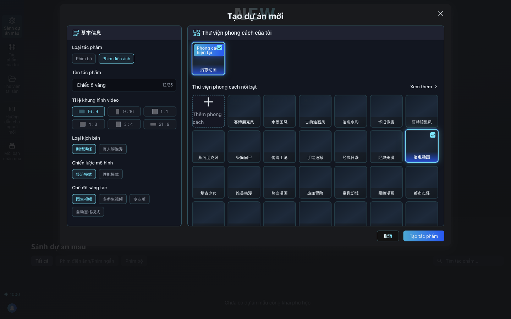
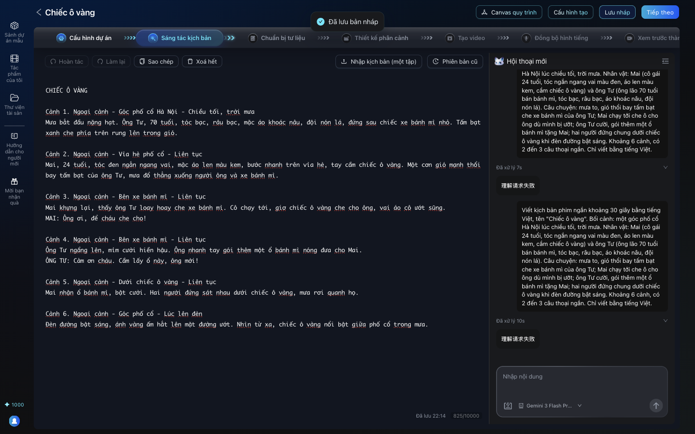

# Bài 02. Tạo dự án và kịch bản

**Mục tiêu:** có một dự án phim với kịch bản tiếng Việt đã lưu.

**Thời lượng gợi ý:** 5 phút.

## Cảnh quay 0. Đăng nhập

**Thao tác:** mở trang AID (ví dụ http://localhost:3000) > **Đăng nhập** (góc trái dưới) > chọn cách
đăng nhập bằng mật khẩu > nhập email và mật khẩu tài khoản của bạn > **Đăng nhập**. Góc trái dưới
hiện số điểm là đã vào được.

## Cảnh quay 1. Tạo dự án

**Lời dẫn:**
> Đăng nhập AID, bấm Bắt đầu sáng tác. Chọn Phim điện ảnh, đặt tên phim. Tỉ lệ 16:9 cho video ngang
> trên YouTube, 9:16 nếu làm TikTok. Chế độ sáng tác chọn "图生视频", nghĩa là tạo video từ ảnh: mình
> sẽ làm ảnh trước rồi mới thành video, đây là cách giữ nhân vật ổn định nhất. Phong cách chọn
> "治愈动画", hoạt hình chữa lành.

**Thao tác:**

1. Trang chủ > **Bắt đầu sáng tác**.
2. Loại tác phẩm: **Phim điện ảnh**. Tên tác phẩm: `Chiếc ô vàng`. Tỉ lệ: **16 : 9**.
3. Loại kịch bản: **剧情演绎** (diễn kịch). Chiến lược mô hình: để mặc định **经济模式** (tiết kiệm).
4. Chế độ sáng tác: **图生视频** (ảnh thành video).
5. Phong cách: ở lưới "Thư viện phong cách nổi bật" bên phải, bấm ô **治愈动画** (hoạt hình chữa lành).
   Các ô có thể chưa có hình minh họa, vẫn bấm được. Bấm **Tạo tác phẩm**.

## Cảnh quay 2. Kịch bản viết thế nào cho AI dễ hiểu

**Lời dẫn:**
> Kịch bản phim AI nên chia thành từng cảnh đánh số. Mỗi cảnh ghi rõ: trong nhà hay ngoài trời, ở đâu,
> lúc nào; ai xuất hiện; họ làm gì; câu thoại viết dạng TÊN: lời. Lần đầu nhân vật xuất hiện, tả kỹ
> ngoại hình: tuổi, tóc, quần áo, đồ vật đặc trưng. AI sẽ dựa vào đó để tách nhân vật ở bước sau.
> Phim ngắn 30 giây thì khoảng 6 cảnh, mỗi cảnh 5 giây.

**Thao tác:** hiện kịch bản mẫu trong [prompt-pack.md](prompt-pack.md#kich-ban-mau).

## Cảnh quay 3. Dán kịch bản vào AID

**Lời dẫn:**
> Ở bước Sáng tác kịch bản, bạn có thể gõ thẳng, dán vào, hoặc bấm Nhập kịch bản (một tập) để tải file. Nút
> AI viết kịch bản cũng có, nhưng khi mình thử với Gemini miễn phí nó báo lỗi "理解请求失败", nên mình
> khuyên tự viết, hoặc nhờ ứng dụng Gemini viết hộ rồi dán vào. Dán xong bấm Lưu nháp.

**Thao tác:**

1. Bấm vào vùng soạn thảo, dán kịch bản.
2. Bấm **Lưu nháp** (góc trên phải). Góc dưới hiện "Đã lưu".

## Lỗi hay gặp

| Hiện tượng | Cách xử lý |
|---|---|
| Ô chat "AI viết kịch bản" báo "理解请求失败" / "Tạo thất bại" | Bỏ qua, tự viết hoặc dùng ứng dụng Gemini rồi dán vào |
| Kịch bản nhiều tập dán một lần | AID yêu cầu mỗi tác phẩm một tập; tách ra |

## Bản chuyên nghiệp

- "Chiến lược mô hình": chọn **性能模式** (chế độ hiệu năng) để ưu tiên model mạnh hơn; **经济模式** là
  chế độ tiết kiệm.
- Kịch bản càng rõ (bối cảnh, ngoại hình nhân vật, câu thoại) thì AI ở các bước sau càng làm đúng, dù
  dùng model nào.
