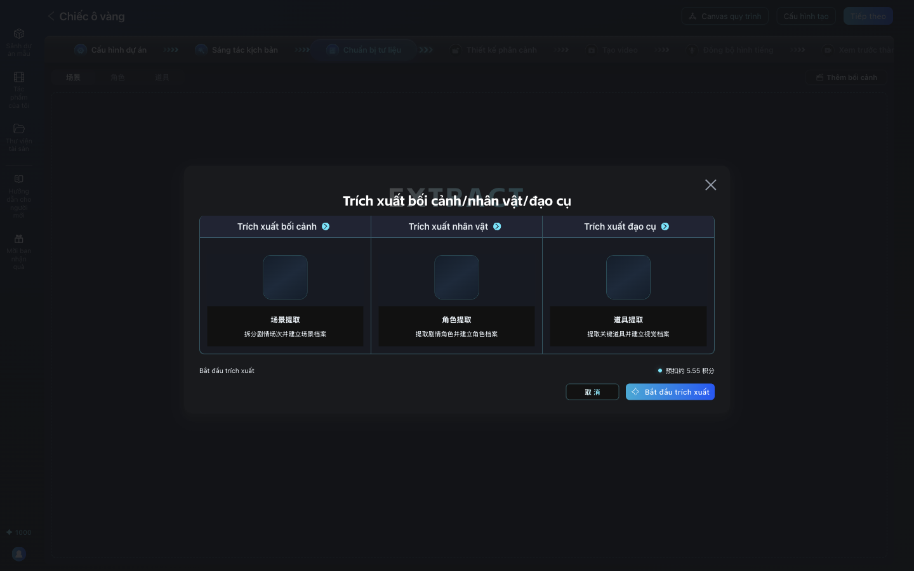
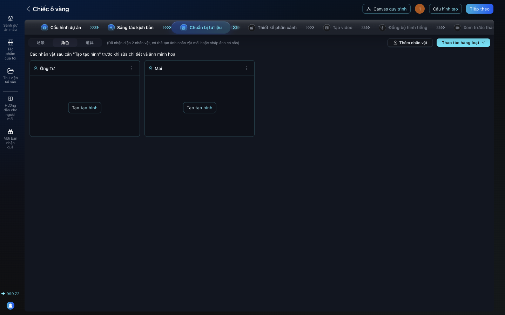
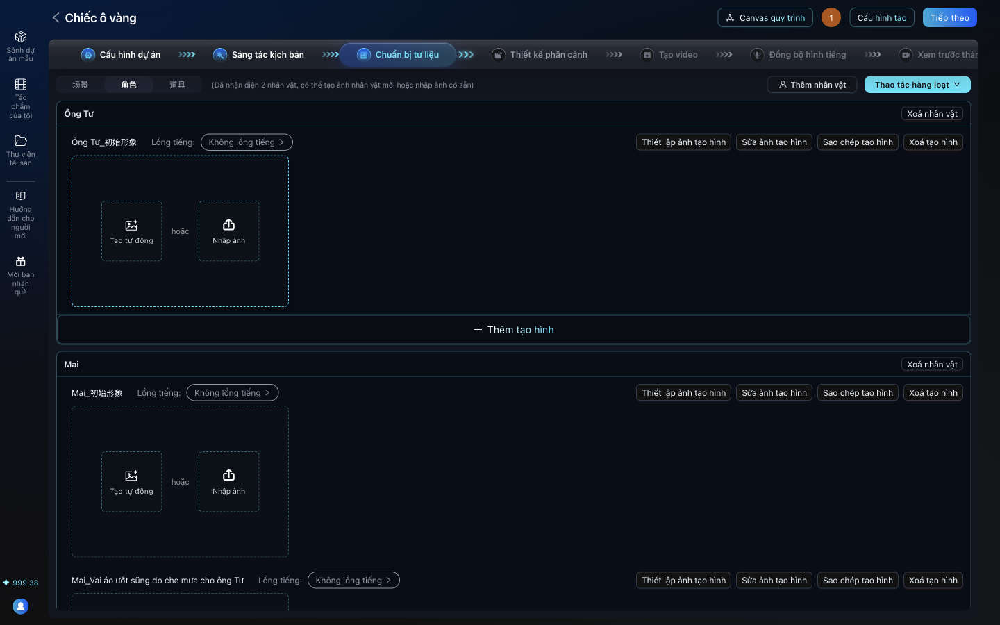
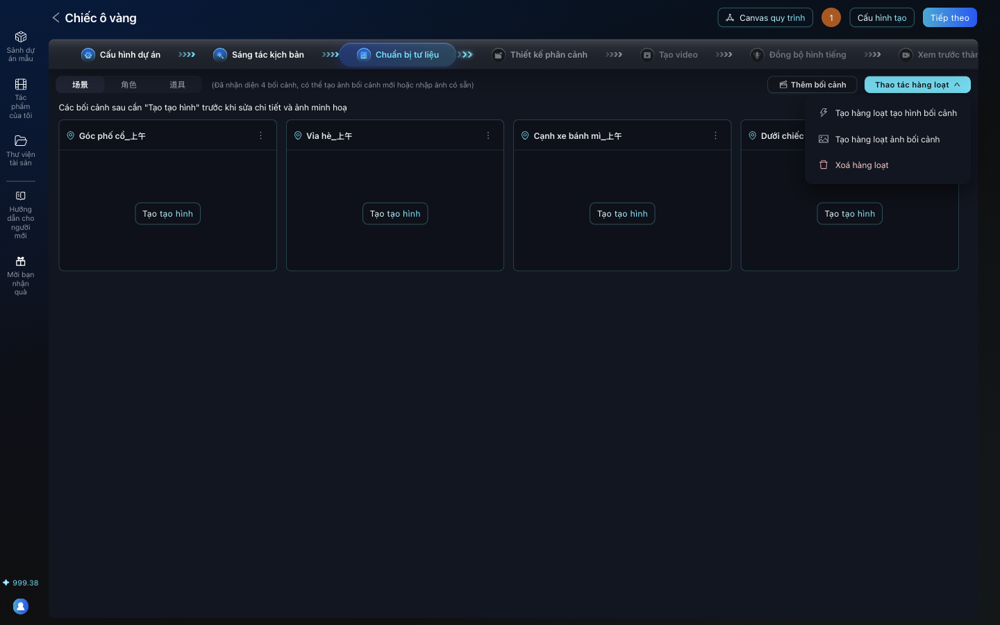

# Bài 03. Chuẩn bị tư liệu: để AI tách nhân vật và bối cảnh

**Mục tiêu:** AID tự đọc kịch bản, lập danh sách nhân vật, bối cảnh, và viết mô tả tạo hình cho từng
nhân vật. Bước này dùng Gemini miễn phí.

**Thời lượng gợi ý:** 5 phút.

## Cảnh quay 1. Tự động trích xuất

**Lời dẫn:**
> Bấm Tiếp theo để sang Chuẩn bị tư liệu. Bấm Tự động trích xuất bối cảnh. AID mở hộp thoại cho chọn
> trích xuất bối cảnh, nhân vật và đạo cụ, kèm số điểm dự kiến. Bấm Bắt đầu trích xuất và chờ khoảng
> hai mươi giây.

**Thao tác:**

1. **Tiếp theo** > bước **Chuẩn bị tư liệu**.
2. **Tự động trích xuất bối cảnh** > **Bắt đầu trích xuất**.

## Cảnh quay 2. Đọc kết quả

**Lời dẫn:**
> AID tìm ra 4 bối cảnh và 2 nhân vật là Ông Tư và Mai. Ba tab ở góc trái là 场景 (bối cảnh), 角色
> (nhân vật), 道具 (đạo cụ). Một lưu ý: AI ghi các bối cảnh là "上午", nghĩa là buổi sáng, dù kịch bản
> nói chiều tối. Đây là lý do mình luôn đọc lại kết quả của AI, và sẽ tự quyết định ánh sáng khi vẽ ở
> bài sau.

**Thao tác:** bấm tab **角色** để xem nhân vật, rồi tab **场景** để xem bối cảnh.

## Cảnh quay 3. Tạo hình nhân vật

**Lời dẫn:**
> Mỗi nhân vật có nút Tạo tạo hình. AI viết một đoạn mô tả ngoại hình chi tiết cho nhân vật đó.
> Với Mai, AI còn tự hiểu là có hai trạng thái: hình ban đầu, và lúc vai áo bị mưa làm ướt. Mỗi trạng
> thái là một "tạo hình" riêng, sau này mỗi cái sẽ có một ảnh riêng.

**Thao tác:** ở từng nhân vật, bấm **Tạo tạo hình**. Chờ nhân vật này xong rồi mới bấm nhân vật tiếp
theo: AID chỉ chạy một tác vụ tạo hình mỗi lúc cho một dự án, bấm chồng sẽ bị từ chối.

Mỗi lần chạy AI cho kết quả hơi khác. Lần quay video, AI chỉ tạo một trạng thái cho Mai (không có "vai
áo ướt"); bài 04 chỉ cách tự thêm.

## Cảnh quay 4. Tạo hình bối cảnh hàng loạt

**Lời dẫn:**
> Với bối cảnh, dùng Thao tác hàng loạt cho nhanh: Tạo hàng loạt tạo hình bối cảnh, chọn tất cả, bấm
> Tạo hàng loạt.

**Thao tác:** tab **场景** > **Thao tác hàng loạt** > **Tạo hàng loạt tạo hình bối cảnh** >
**Chọn tất cả** > **Tạo hàng loạt**.

**Mẹo lượt miễn phí (đã chạy khi quay video):** Gemini 3.6 Flash miễn phí chỉ có khoảng 20 lượt mỗi ngày
và 5 lượt mỗi phút, mà tạo hàng loạt gửi một lượt cho mỗi bối cảnh cùng lúc, nên dễ báo lỗi 429. Trước khi
tạo hàng loạt: **Cấu hình tạo** (góc trên) > **Trích xuất tạo hình (văn bản)** > bấm ô model ở dòng "Tạo
hình bối cảnh" > **Gemini 3.1 Flash-Lite** (500 lượt mỗi ngày) > **OK** > **OK**.

## Cảnh quay 5. Vì sao không bấm "Tạo tự động" để vẽ ảnh

**Lời dẫn:**
> Mỗi tạo hình giờ có hai nút: Tạo tự động và Nhập ảnh. Tạo tự động sẽ vẽ ảnh bằng model tạo ảnh của
> AID, mà model đó phải trả phí. Mình sẽ dùng Nhập ảnh, với ảnh vẽ miễn phí bằng ứng dụng Gemini. Đó là
> bài tiếp theo, và là bài quan trọng nhất.

## Lỗi hay gặp

| Hiện tượng | Cách xử lý |
|---|---|
| "本次生成未完成，稍后重试" (lần tạo này chưa xong, thử lại sau) | Máy chủ Google quá tải (lỗi 503). Chờ vài giây, bấm lại |
| Tạo hàng loạt bối cảnh lỗi gần hết | Hết lượt mỗi phút hoặc mỗi ngày của Gemini 3.6 Flash (lỗi 429). Chờ một phút, hoặc đổi sang Flash-Lite như mẹo ở cảnh quay 4 |
| Bấm Tạo tạo hình nhân vật thứ hai không có gì xảy ra | Nhân vật trước chưa xong. Chờ xong rồi bấm lại |
| Bối cảnh bị ghi sai thời gian trong ngày | Sửa bằng "Sửa thiết lập bối cảnh", hoặc ghi rõ khi vẽ ảnh |

## Bản chuyên nghiệp: chọn model trong "Cấu hình tạo"

Video mở **Cấu hình tạo** (góc trên) ngay đầu bài này. Đây là nơi chọn model cho từng việc của dự án:

- **Trích xuất tài sản (văn bản)** và **Trích xuất tạo hình (văn bản)**: bản miễn phí chọn Gemini 3.1
  Flash-Lite (gói miễn phí 500 lượt mỗi ngày). Có key xịn thì chọn model chữ mạnh như GPT-5.5, Qwen 3.7
  Max hay DeepSeek V4 Pro.
- **Tạo ảnh tạo hình (ảnh)** và **Tạo ảnh phân cảnh (ảnh)**: chọn model ảnh như Nano Banana Pro, Seedream
  5.0 Pro hay GPT Image 2, rồi dùng nút **Tạo tự động** ở từng tạo hình thay cho **Nhập ảnh**.

Cách bấm: Cấu hình tạo > chọn mục bên trái > bấm ô model của từng việc > chọn ở "Mô hình khả dụng" > **OK**
> **OK**. Danh sách model hiện ra tùy nhà cung cấp mà trang AID của bạn bật.
