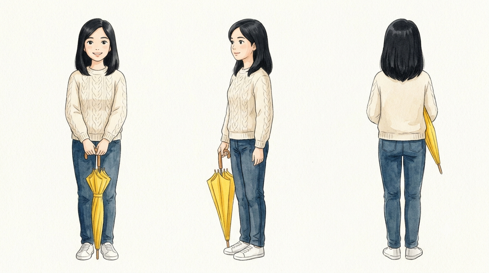
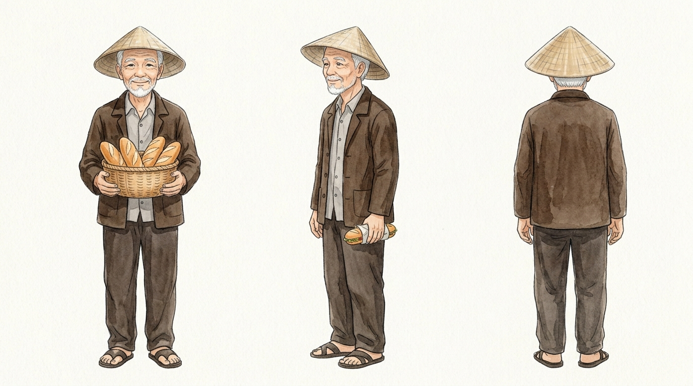
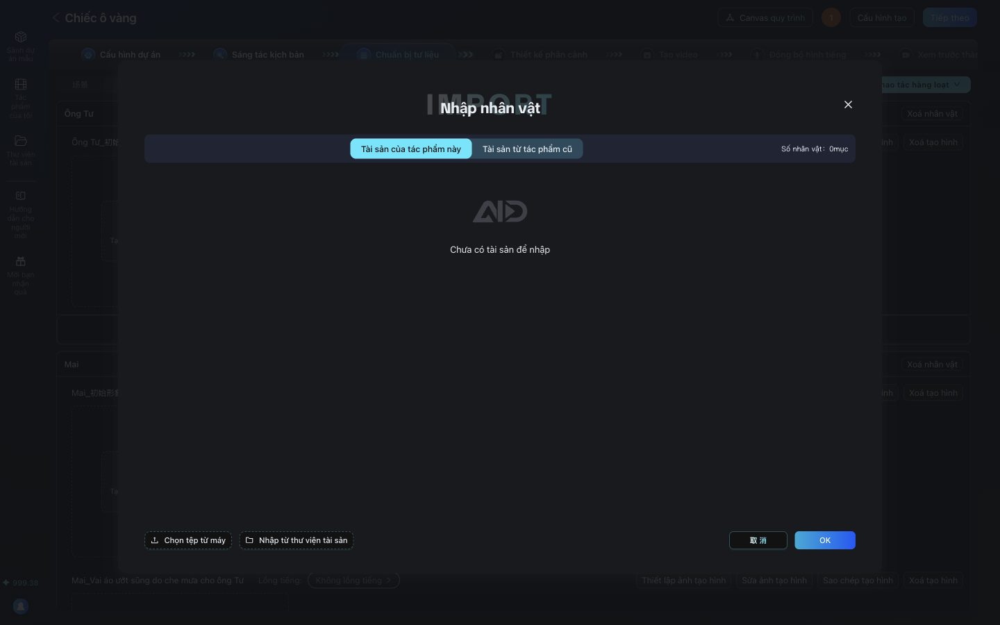
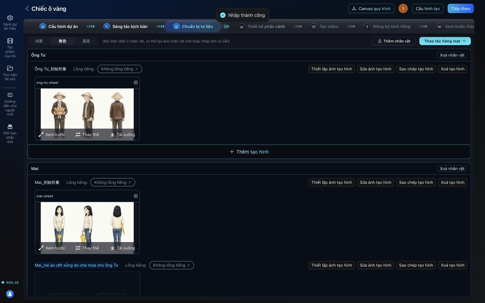
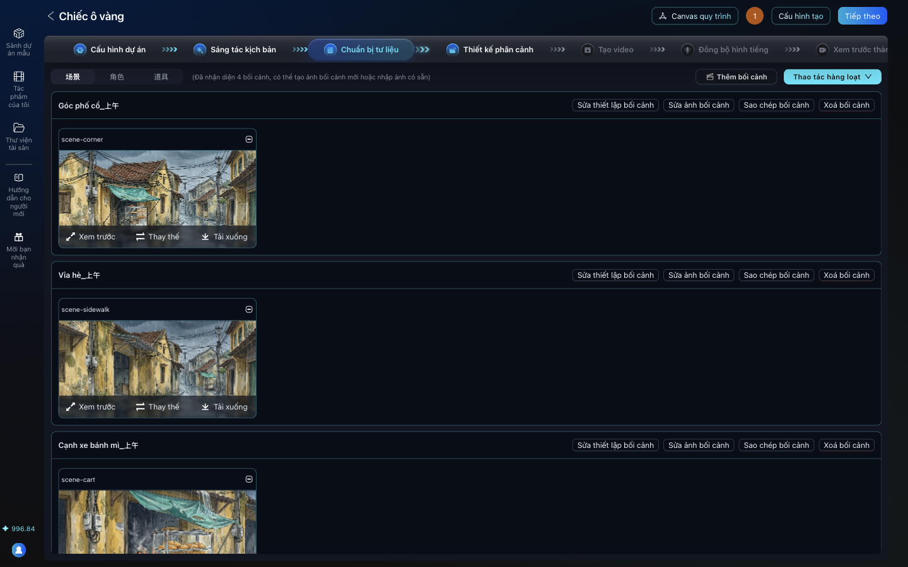

# Bài 04. Giữ nhân vật nhất quán: vẽ "thẻ nhân vật" bằng Gemini và nhập vào AID

**Mục tiêu:** mỗi nhân vật có một ảnh mẫu ba góc nhìn (character sheet) làm "chuẩn", và mọi ảnh sau đều
bám theo chuẩn đó. Đây là bài quyết định phim của bạn trông chuyên nghiệp hay nghiệp dư.

**Thời lượng gợi ý:** 12 phút.

**Công cụ:** ứng dụng Gemini miễn phí tại https://gemini.google.com (đăng nhập tài khoản Google).
Trong lần chạy thử, một buổi tạo 14 ảnh trên tài khoản miễn phí mà không bị chặn.

## Năm quy tắc vàng (đọc to ở đầu video)

1. **Một phim, một cuộc trò chuyện.** Tạo mọi ảnh của phim trong cùng một cuộc chat Gemini. Gemini nhớ
   các ảnh trước, nên nét vẽ và khuôn mặt giữ nguyên.
2. **Vẽ thẻ nhân vật trước, ba góc nhìn, nền trắng.** Chính diện, nghiêng 3/4, sau lưng, đứng cạnh nhau.
3. **Thẻ nhận dạng cố định.** Mỗi nhân vật có một câu tả ngắn không bao giờ đổi (ví dụ: "Mai: tóc đen
   ngắn ngang vai, áo len đan màu kem, quần jean xanh đậm, giày thể thao trắng, ô vàng"). Lặp lại câu này
   trong mọi prompt, kèm "đúng nhân vật Mai ở trên".
4. **Soi từng ảnh mới với thẻ nhân vật.** Kiểm tra: độ dài tóc, màu áo, phụ kiện, khuôn mặt. Lệch là sửa
   ngay, đừng để sang cảnh sau.
5. **Sửa bằng câu cụ thể.** Đừng viết "vẽ lại cho giống". Viết: "Tóc Mai phải ngắn ngang vai, không dài
   quá vai. Vết ướt chỉ là màu kem sẫm hơn, không phải màu nâu. Giữ nguyên mọi thứ khác."

## Cảnh quay 1. Mở Gemini và vẽ thẻ nhân vật đầu tiên

**Lời dẫn:**
> Mở gemini.google.com, bắt đầu cuộc trò chuyện mới. Mình dán prompt tạo thẻ nhân vật cho Mai. Để ý
> prompt có bốn phần: phong cách vẽ, khung hình 16:9, mô tả nhân vật thật cụ thể, và yêu cầu ba góc
> nhìn trên nền trắng. Nền trắng giúp AI tập trung vào nhân vật, không lẫn với cảnh.

**Thao tác:** dán prompt "Thẻ nhân vật Mai" trong [prompt-pack.md](prompt-pack.md#the-nhan-vat). Chờ
khoảng một phút (trong lần chạy thử, mỗi ảnh xong trong vòng 40 đến 55 giây).

## Cảnh quay 2. Tải ảnh về đúng cách

**Lời dẫn:**
> Rê chuột lên ảnh, bấm biểu tượng tải xuống "Download full size image" để lấy ảnh chất lượng gốc. Đừng
> chụp màn hình. Ảnh về thư mục Downloads với tên kiểu Gemini_Generated_Image. Mình đổi tên ngay cho dễ
> nhớ: mai-sheet.png.

## Cảnh quay 3. Nhân vật thứ hai, cùng nét vẽ

**Lời dẫn:**
> Vẫn trong cuộc chat đó, mình yêu cầu thẻ nhân vật ông Tư và mở đầu bằng "Giữ nguyên đúng phong cách
> vẽ, nét vẽ và bảng màu của ảnh vừa rồi". Nhờ vậy hai nhân vật trông như cùng một bộ phim.

**Thao tác:** dán prompt "Thẻ nhân vật ông Tư", tải về, đặt tên `ong-tu-sheet.png`.

## Cảnh quay 4. Trạng thái thứ hai của nhân vật, và cách sửa khi bị lệch

**Lời dẫn:**
> Trong phim, Mai bị ướt vai khi che mưa cho ông Tư. AID đã tách đó thành một tạo hình riêng. Mình nhờ
> Gemini vẽ Mai với vai áo ướt. Kết quả lần đầu: tóc dài quá vai và vết ướt thành màu bùn nâu. So với
> thẻ nhân vật là thấy sai ngay. Mình không vẽ lại từ đầu mà sửa bằng một câu cụ thể. Lần hai thì đúng.

**Thao tác:** dán prompt "Mai ướt vai", soi lỗi, dán prompt "Sửa lệch". Chiếu ảnh so sánh.

## Cảnh quay 5. Nhập ảnh nhân vật vào AID

**Lời dẫn:**
> Quay lại AID, bước Chuẩn bị tư liệu, tab nhân vật. Ở mỗi tạo hình, bấm Nhập ảnh. Hộp thoại Nhập nhân
> vật mở ra, bấm Chọn tệp từ máy, chọn đúng ảnh. AID báo Nhập thành công và ảnh hiện ngay trong tạo
> hình. Làm lần lượt: ông Tư ban đầu, Mai ban đầu, Mai ướt vai.

**Thao tác:**

1. Tab **角色** (nhân vật). Ở tạo hình "Ông Tư_初始形象" (ban đầu): **Nhập ảnh**.
2. Trong hộp thoại "Nhập nhân vật": **Chọn tệp từ máy** > chọn `ong-tu-sheet.png`. AID nhập ngay và báo
   "Nhập thành công", không cần bấm OK; nếu hộp thoại vẫn mở, đóng bằng dấu x.
3. Lặp lại cho "Mai_初始形象" (`mai-sheet.png`) và "Mai_Vai áo ướt..." (`mai-wet.png`).
4. Nếu AI không tạo trạng thái thứ hai cho Mai: ở nhân vật Mai bấm **Thêm tạo hình**. Một tạo hình mới
   tên "未命名" (chưa đặt tên) hiện ra; bấm **Nhập ảnh** ở đó và chọn `mai-wet.png`.

## Cảnh quay 6. Bối cảnh: cùng nguyên tắc

**Lời dẫn:**
> Bối cảnh cũng cần nhất quán: cùng con phố, cùng chiếc xe bánh mì. Vẫn trong cuộc chat cũ, mình vẽ
> góc phố trước, rồi các góc khác ghi "cùng con phố trong ảnh vừa rồi". Lưu ý: ảnh bối cảnh không có
> người. Sau đó nhập vào từng bối cảnh trong tab 场景 bằng nút Nhập ảnh, giống hệt nhân vật.

**Thao tác:** dán 4 prompt bối cảnh trong prompt pack, tải về, nhập vào 4 bối cảnh.

**Mẹo nói thêm:** bản "phố lúc lên đèn" không giữ đúng từng chi tiết của góc phố gốc, nhưng vẫn cùng
một con phố, chấp nhận được với cảnh toàn từ xa. Cảnh nào nhân vật xuất hiện gần thì phải khắt khe hơn.

## Kiểm tra cuối bài

- Ba tạo hình nhân vật và bốn bối cảnh đều có ảnh.
- Đặt các ảnh cạnh nhau: cùng một nét vẽ, cùng bảng màu.

## Lỗi hay gặp

| Hiện tượng | Cách xử lý |
|---|---|
| Nhân vật đổi kiểu tóc, màu áo | Sửa bằng câu cụ thể (quy tắc 5), nhắc lại thẻ nhận dạng |
| Hai nhân vật khác nét vẽ | Tạo trong cùng một cuộc chat; mở đầu prompt bằng "Giữ nguyên phong cách ảnh trước" |
| Không thấy nút tải xuống | Rê chuột lên ảnh; nút hiện ở góc trên ảnh |
| Gemini báo hết lượt tạo ảnh hôm nay | Chờ sang ngày; giới hạn của gói miễn phí thay đổi theo Google |
