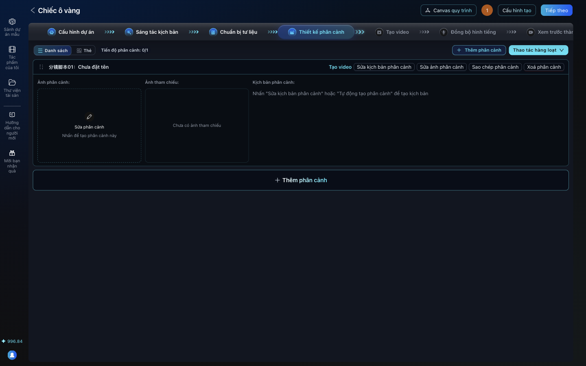
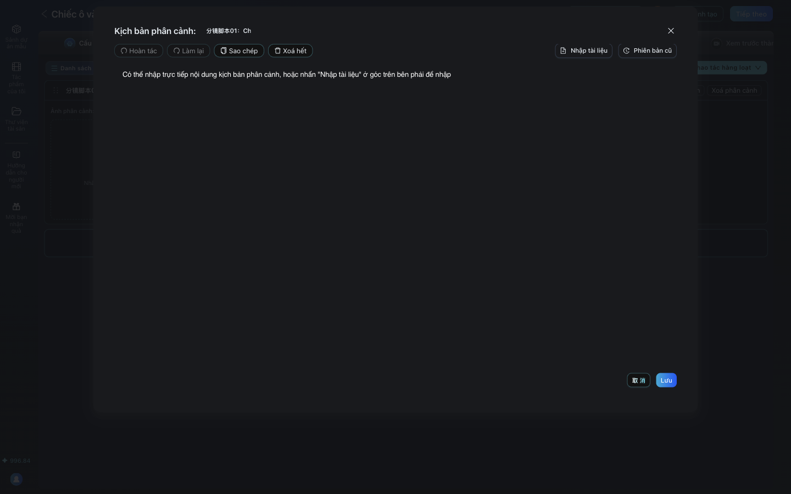
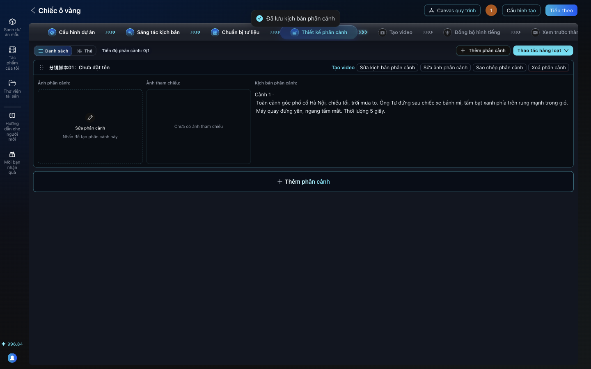
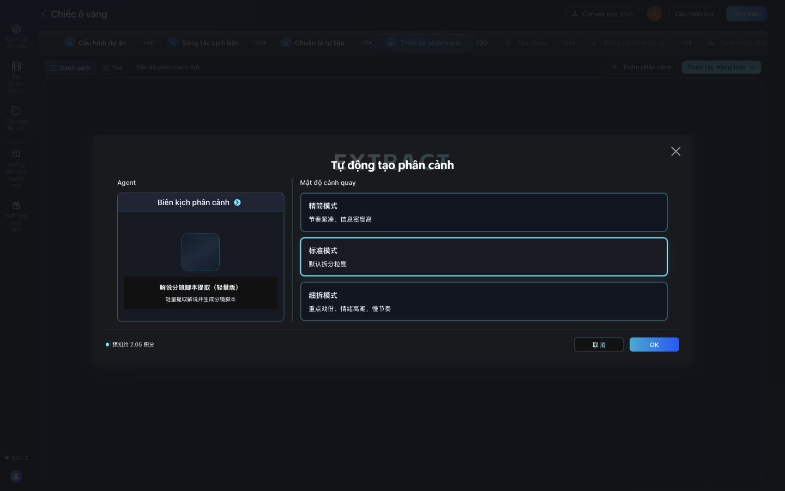
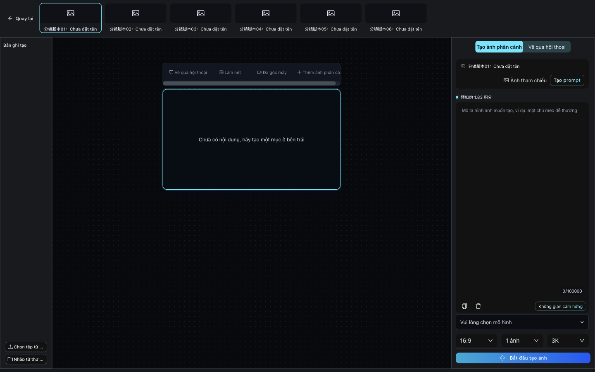
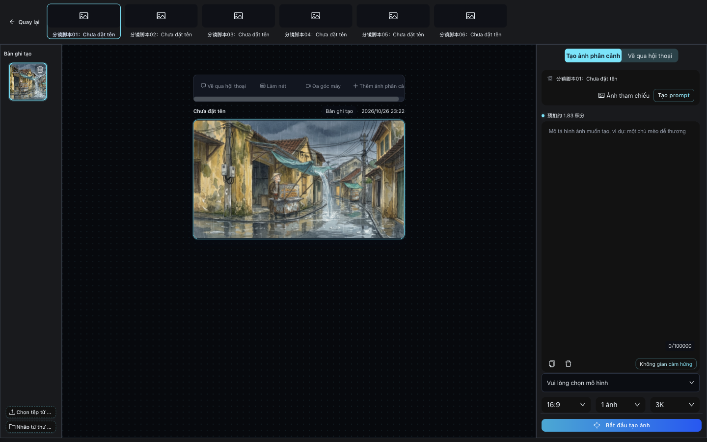

# Bài 05. Thiết kế phân cảnh và vẽ ảnh phân cảnh giữ đúng nhân vật

**Mục tiêu:** phim có 6 phân cảnh, mỗi phân cảnh có kịch bản và một ảnh, trong đó nhân vật và bối cảnh
khớp với thẻ nhân vật đã làm.

**Thời lượng gợi ý:** 10 phút.

## Cảnh quay 1. Thêm phân cảnh bằng tay (cách đã chạy thành công)

**Lời dẫn:**
> Sang bước Thiết kế phân cảnh. Mình thêm từng phân cảnh bằng tay: với phim 6 cảnh chỉ mất vài phút, và
> mình kiểm soát được từng cảnh. Bấm Thêm phân cảnh, một thẻ phân cảnh mới hiện ra. Bấm Sửa kịch bản
> phân cảnh, viết: cỡ cảnh (toàn, trung, cận), ai làm gì, câu thoại nếu có, chuyển động máy quay, và
> thời lượng 5 giây. Bấm Lưu. Làm lần lượt cho cả 6 cảnh.

**Thao tác:**

1. **Thêm phân cảnh** (giữa màn hình khi chưa có phân cảnh nào, hoặc góc trên phải).
2. Trên thẻ phân cảnh: **Sửa kịch bản phân cảnh** > dán đoạn kịch bản cảnh (lấy trong
   [prompt-pack.md](prompt-pack.md#kich-ban-phan-canh)) > **Lưu**. Thấy thông báo "Đã lưu kịch bản
   phân cảnh".
3. Lặp lại tới khi dòng "Tiến độ phân cảnh" ghi **0/6** (6 phân cảnh, chưa có ảnh).

## (Tùy chọn) Để AI tự chia phân cảnh

**Chưa chạy được trong lần thử:** cả 5 lần đều lỗi (Google quá tải, hết lượt miễn phí trong ngày, hoặc
model nhẹ trả về sai định dạng). Bạn có thể thử khi Google không quá tải; nếu lỗi, quay về cách thủ công.

**Thao tác:**

1. **Thao tác hàng loạt** > **Tự động tạo phân cảnh**.
2. Bấm vào thẻ Agent **Biên kịch phân cảnh**. Hộp thoại "Chọn agent" mở ra. Nếu ô tìm kiếm có sẵn chữ
   "Phân cảnh" và báo "Không tìm thấy agent phù hợp", bấm dấu x trong ô để xóa chữ.
3. Chọn agent **分镜脚本提取（轻量版）** (tách kịch bản phân cảnh, bản nhẹ; mặc định đang là bản cho phim
   có lời dẫn 解说...). Ở mục **Mô hình khả dụng** chọn **Gemini 3.6 Flash** > **OK**.
4. Chọn mật độ (mặc định là 标准模式, chuẩn; lần thử dùng 精简模式, gọn) > **OK**.

## Cảnh quay 2. Vẽ ảnh phân cảnh trong cùng cuộc chat Gemini

**Lời dẫn:**
> Quay lại đúng cuộc chat Gemini đã vẽ nhân vật. Với mỗi cảnh, prompt luôn có ba phần: "đúng nhân vật
> ... ở trên", "đúng bối cảnh ... ở trên", và hành động trong cảnh. Đây là lúc năm quy tắc vàng phát huy
> tác dụng: nhìn sáu ảnh này, Mai vẫn tóc ngắn, áo len kem, ông Tư vẫn nón lá, áo nâu.

**Thao tác:** dán lần lượt 6 prompt "Cảnh 1" tới "Cảnh 6" trong prompt pack, tải về, đặt tên
`shot-1.png` tới `shot-6.png` và để chung một thư mục (tên này cần cho bài 06).

**Soi lỗi:** ở cảnh 1, phía xa có thêm một xe bánh mì thứ hai. Lỗi nhỏ ở hậu cảnh, chấp nhận được. Lỗi ở
nhân vật chính thì phải sửa.

## Cảnh quay 3. Nhập ảnh vào từng phân cảnh

**Lời dẫn:**
> Bấm Sửa phân cảnh ở ô ảnh của thẻ phân cảnh đầu tiên. Màn hình chỉnh ảnh mở ra, trên cùng là các tab
> 分镜脚本01 tới 06, tức phân cảnh 1 tới 6. Góc dưới trái bấm Chọn tệp từ máy, chọn shot-1.png. Ảnh vào
> mục Bản ghi tạo. Chưa xong đâu: phải bấm Thêm ảnh phân cảnh, nút cuối cùng bên phải thanh công cụ phía
> trên ảnh. AID báo Thiết lập thành công thì ảnh mới thành ảnh chính của phân cảnh. Bấm tab 02 và làm
> tiếp.

**Thao tác (cho từng phân cảnh):**

1. Bấm tab **分镜脚本0N** ở trên cùng.
2. Góc dưới trái: **Chọn tệp từ máy** > chọn `shot-N.png`.
3. Thanh công cụ trên ảnh: **Thêm ảnh phân cảnh** (nút cuối bên phải; nếu bị che, kéo thanh cuộn ngang
   của thanh công cụ). Chờ thông báo "Thiết lập thành công".
4. Xong cả 6: bấm **Quay lại**.

**Bản miễn phí thì không bấm** "Bắt đầu tạo ảnh", "Làm nét", "Đa góc máy": đó là các nút tạo ảnh bằng model trả phí (xem mục Bản chuyên nghiệp).

## Lỗi hay gặp

| Hiện tượng | Cách xử lý |
|---|---|
| Đã chọn ảnh nhưng phân cảnh vẫn trống | Chưa bấm **Thêm ảnh phân cảnh**. Ảnh mới chỉ nằm trong "Bản ghi tạo" |
| Ô chọn agent báo "Không tìm thấy agent phù hợp" | Xóa chữ "Phân cảnh" có sẵn trong ô tìm kiếm |
| "Tự động tạo phân cảnh" lỗi hoặc chạy xong mà không có cảnh nào | Dùng cách thủ công ở cảnh quay 1 |

## Bản chuyên nghiệp

Trong màn hình chỉnh ảnh phân cảnh: viết mô tả ở khung bên phải, thêm ảnh thẻ nhân vật làm **ảnh tham
chiếu**, chọn model ảnh, rồi bấm **Bắt đầu tạo ảnh**. AI vẽ ảnh phân cảnh bám theo ảnh tham chiếu. "Làm
nét" và "Đa góc máy" cũng dùng model trả phí.
