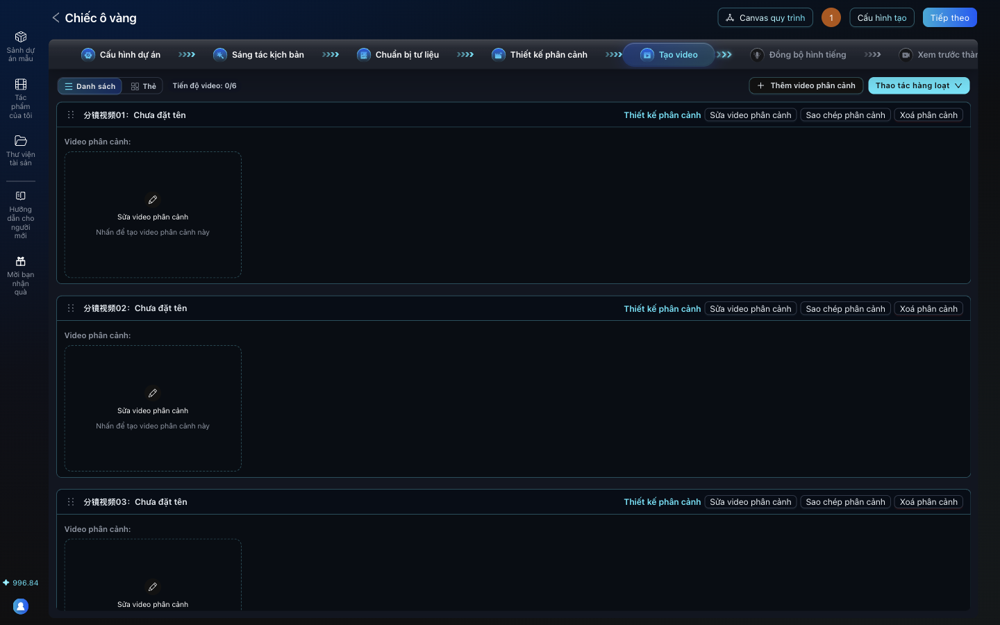
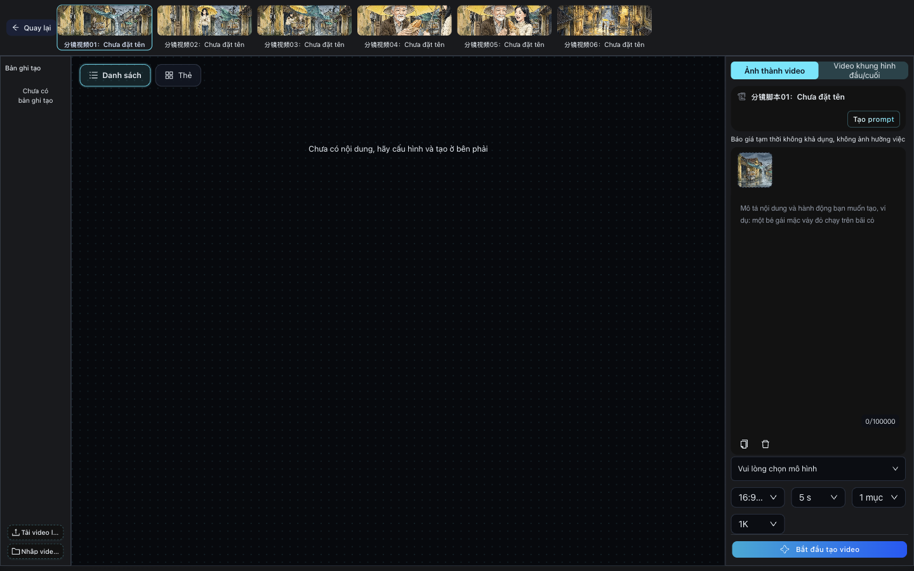
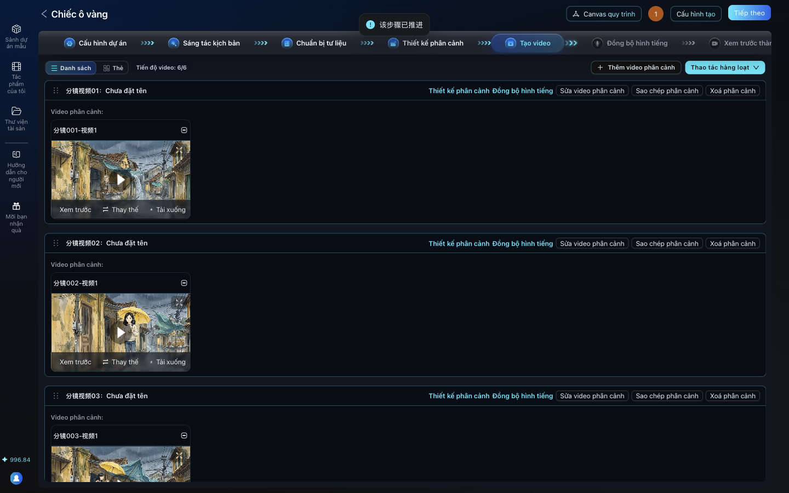

# Bài 06. Sinh video và lồng tiếng

**Mục tiêu:** mỗi phân cảnh có một clip 5 giây có chuyển động máy quay, những cảnh có thoại thì có giọng
nói, và cả 6 clip đã gắn vào AID.

**Thời lượng gợi ý:** 8 phút.

**Cần có:** máy Mac có Homebrew. Cài FFmpeg một lần: `brew install ffmpeg ffmpeg-full` (bản thường cho
các lệnh lẻ, bản đầy đủ cho phụ đề). Ba script nằm trong thư mục `vi/tutorial/tools/` của fork AID Studio tiếng Việt; tải thư mục đó về, để trên Desktop với tên `aid-tools`.
Linux có FFmpeg cũng chạy được các script, nhưng chưa được thử, và lệnh tạo giọng `say` chỉ có trên Mac.

## Cảnh quay 1. Vì sao không bấm "Bắt đầu tạo video" trong AID

**Lời dẫn:**
> Trong bước Tạo video, AID có thể nhờ các model video AI biến ảnh thành video thật sự chuyển động. Các
> model đó đều trả phí. Cách miễn phí: tạo hiệu ứng máy quay từ chính ảnh phân cảnh, gọi là hiệu ứng Ken
> Burns: phóng to chậm, lia ngang, kéo ra xa. Phim truyện tranh động dùng đúng kỹ thuật này. Và vì dùng
> chính ảnh đã duyệt, nhân vật không thể bị đổi mặt.

## Cảnh quay 2. Tạo 6 clip bằng một lệnh

**Lời dẫn:**
> Đặt 6 ảnh shot-1 tới shot-6 vào một thư mục, chạy script make-clips. Mỗi ảnh thành một clip 5 giây,
> 1280 x 720, với chuyển động lần lượt: phóng vào, lia ngang, phóng vào, đẩy vào nhân vật, kéo ra, kéo
> ra. Chỉ mất vài giây.

**Thao tác:** mở Terminal, giả sử 6 ảnh nằm trong thư mục `anh` của Desktop:

```sh
T=~/Desktop/aid-tools
mkdir -p ~/Desktop/phim
$T/make-clips.sh ~/Desktop/anh ~/Desktop/phim/clips
```

Ảnh có thể là `.png` hoặc `.jpg`. Ảnh không đúng tỉ lệ 16:9 sẽ được cắt phần giữa.
**Muốn đổi chuyển động:** sửa dòng `MOVES="in pan in push out out"` trong script (`in` phóng vào,
`pan` lia ngang, `push` đẩy vào bên trái khung, `out` kéo ra).

## Cảnh quay 3. Thu giọng nói

**Lời dẫn:**
> Giọng nói tốt nhất là tự thu: mở QuickTime, chọn File, New Audio Recording, đọc câu thoại, lưu file.
> Nếu chỉ cần giọng tạm, máy Mac có sẵn giọng đọc tiếng Việt tên Linh, gõ một lệnh là có file. Mình dùng
> giọng Linh cho Mai, và chính giọng Linh nhưng hạ tông cho ông Tư.

**Thao tác (giọng Linh, đã chạy thử):**

```sh
cd ~/Desktop/phim
say -v Linh -r 175 -o mai.aiff "Ông ơi, để cháu che cho!"
say -v Linh -r 160 -o ongtu-raw.aiff "Cảm ơn cháu. Cầm lấy ổ này, ông mời!"
# Hạ tông giọng cho ông Tư. 22050 là tần số mẫu của giọng Linh.
ffmpeg -i ongtu-raw.aiff -af "asetrate=22050*0.8,aresample=44100,atempo=1.15" ongtu.mp3
ffmpeg -i mai.aiff mai.mp3
```

**Nếu tự thu bằng QuickTime (file .m4a):** script ghép giọng nhận thẳng file .m4a, không cần đổi (đã thử
với file .m4a 48000 Hz). Muốn hạ tông một file tự thu, xem tần số mẫu bằng
`ffprobe -v error -show_entries stream=sample_rate tenfile.m4a` rồi thay số 22050 ở lệnh trên bằng số
đó (thường 44100 hoặc 48000); bước hạ tông cho file tự thu chưa chạy thử.

## Cảnh quay 4. Ghép giọng vào clip, cả clip không thoại cũng cần tiếng

**Lời dẫn:**
> Đây là mẹo quan trọng. AID có bước Đồng bộ hình tiếng cho tải giọng lên, nhưng ở bản hiện tại giọng
> tải ở đó chưa được đưa vào phim khi xuất. Thứ AID giữ lại là âm thanh có sẵn trong mỗi clip. Vì vậy
> mình ghép giọng thẳng vào clip trước khi tải lên. Các clip không có thoại vẫn phải có một rãnh âm
> thanh im lặng, để phim xuất ra có tiếng liền mạch.

**Thao tác (vẫn đứng ở thư mục AID Studio, biến `T` như trên):**

```sh
P=~/Desktop/phim
mkdir -p $P/voiced
$T/add-voice.sh $P/clips/shot-1.mp4 $P/voiced/shot-1.mp4                 # im lặng
$T/add-voice.sh $P/clips/shot-2.mp4 $P/voiced/shot-2.mp4
$T/add-voice.sh $P/clips/shot-3.mp4 $P/voiced/shot-3.mp4 $P/mai.mp3 0.6     # Mai nói từ giây 0.6
$T/add-voice.sh $P/clips/shot-4.mp4 $P/voiced/shot-4.mp4 $P/ongtu.mp3 0.6
$T/add-voice.sh $P/clips/shot-5.mp4 $P/voiced/shot-5.mp4
$T/add-voice.sh $P/clips/shot-6.mp4 $P/voiced/shot-6.mp4
```

Số giây bắt đầu viết bằng dấu chấm (`0.6`), không dùng dấu phẩy. Nếu giọng dài hơn clip, script báo
"Warning" và phần thừa bị cắt: rút ngắn câu thoại hoặc cho bắt đầu sớm hơn.

## Cảnh quay 5. Tải clip vào AID

**Lời dẫn:**
> Sang bước Tạo video. Có 6 ô video phân cảnh tương ứng 6 phân cảnh. Bấm Sửa video phân cảnh. Trên
> cùng là các tab 分镜视频01 tới 06. Góc dưới trái bấm Tải video lên, chọn clip. Sau khi tải xong, bấm
> nút 设置为分镜视频, nghĩa là "đặt làm video phân cảnh". AID báo Xác nhận thành công. Làm cho cả 6.

**Thao tác (cho từng phân cảnh):**

1. Tab **分镜视频0N**.
2. Góc dưới trái: **Tải video lên** > chọn `voiced/shot-N.mp4`.
3. Bấm **设置为分镜视频** (đặt làm video phân cảnh). Chờ "Xác nhận thành công".
4. Xong cả 6: **Quay lại**. Dòng "Tiến độ video" ghi **6/6**.





**Bản miễn phí thì không bấm** "Bắt đầu tạo video" (model video trả phí, xem mục Bản chuyên nghiệp), và
đừng dùng nút "Tải lên lồng tiếng từ máy" ở bước Đồng bộ hình tiếng.

## Lỗi hay gặp

| Hiện tượng | Cách xử lý |
|---|---|
| `ffmpeg: command not found` | Chưa cài FFmpeg: `brew install ffmpeg ffmpeg-full` |
| Lệnh `ffmpeg` báo thiếu thư viện (`Library not loaded ... x265`) sau khi cài `ffmpeg-full` | `brew upgrade ffmpeg` |
| Phim xuất ra không có tiếng | Clip chưa có rãnh âm thanh. Chạy `add-voice.sh` cho mọi clip, kể cả clip không thoại |
| Đã tải giọng ở "Đồng bộ hình tiếng" mà phim vẫn câm | Bản hiện tại chưa dùng giọng tải ở bước đó. Ghép giọng vào clip như cảnh quay 4 |
| Lệnh `say` đọc bằng giọng tiếng Anh, sai dấu | Máy chưa có giọng Linh. Kiểm tra bằng `say -v '?' \| grep vi_VN`; nếu trống, tải giọng tiếng Việt trong phần cài đặt giọng đọc (Spoken Content) của macOS |

## Bản chuyên nghiệp: sinh video bằng model AI

Trong màn hình chỉnh video phân cảnh, bấm **Bắt đầu tạo video**, chọn model video: AI biến ảnh phân cảnh
thành cảnh quay có nhân vật cử động, biểu cảm. Model tốt có thể cho cảm giác như người thật đóng. Chọn
model nào, giá tham khảo và cách bắt đầu: xem mục "Chọn model video và chi phí" trong [README](README.md).

Lồng tiếng AI: AID có giọng đọc như Doubao TTS và MiniMax Speech (có cả nhân bản giọng) ở bước Đồng bộ hình
tiếng. Phần này chưa được chạy thử vì cần key trả phí. Một số model video như Veo còn tạo âm thanh kèm.
