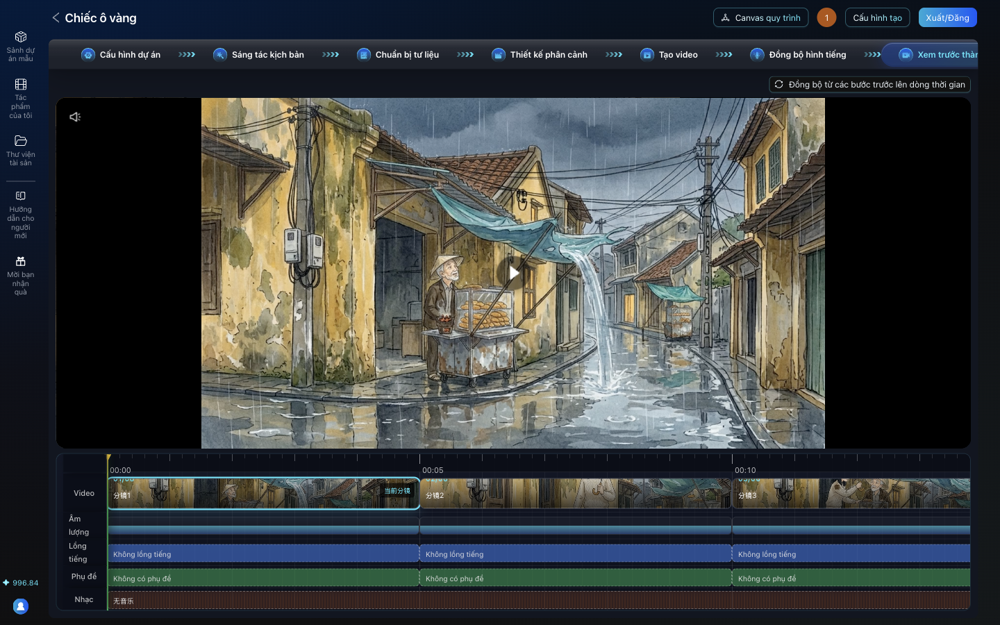
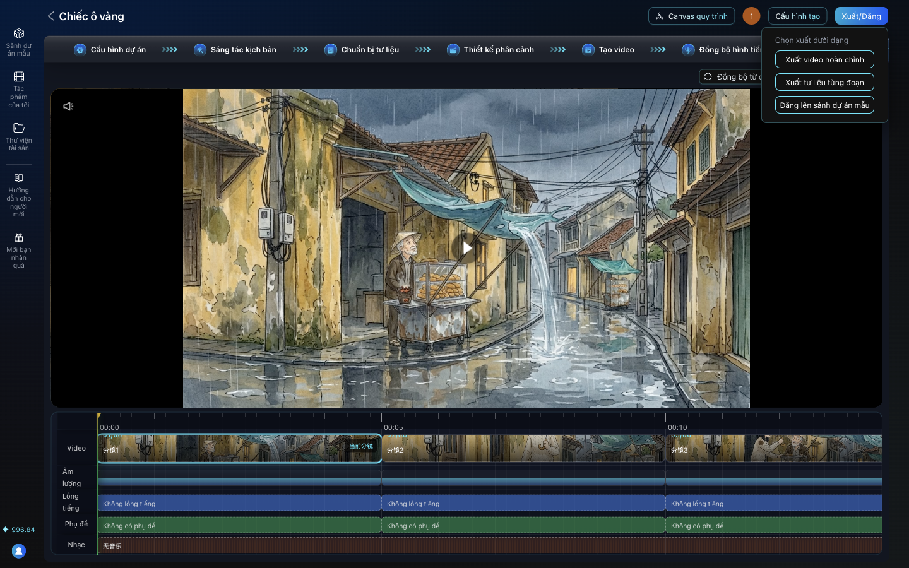
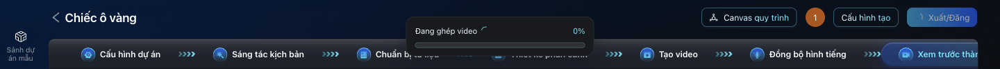

# Bài 07. Ghép phim và gắn phụ đề tiếng Việt

**Mục tiêu:** xuất phim hoàn chỉnh từ AID, rồi ghi phụ đề tiếng Việt cứng vào hình (burn-in).

**Thời lượng gợi ý:** 6 phút.

## Cảnh quay 1. Mở bước Xem trước thành phẩm

**Lời dẫn:**
> Bước cuối là Xem trước thành phẩm. Ở đây có dòng thời gian gồm các rãnh: Video, Âm lượng, Lồng tiếng,
> Phụ đề, Nhạc. Nếu vừa thay clip ở bước trước, bấm Đồng bộ từ các bước trước lên dòng thời gian để AID
> lấy bản mới nhất.

**Thao tác:**

1. Thanh bước: **Xem trước thành phẩm**. (Nếu bấm Tiếp theo mà AID báo "该步骤已推进", nghĩa là "bước
   này đã chuyển rồi", hãy bấm thẳng tên bước trên thanh bước.)
2. Bấm **Đồng bộ từ các bước trước lên dòng thời gian**. Thông báo "Đã đặt lại dòng thời gian theo dữ
   liệu phân cảnh mới nhất".



## Cảnh quay 2. Để trống phụ đề của AID

**Lời dẫn:**
> AID tự làm phụ đề, nhưng nó chia mỗi màn hình tối đa 12 ký tự, cách chia dành cho chữ Trung. Với tiếng
> Việt, câu "Ông ơi, để cháu che cho!" bị cắt thành "Ông ơi đ" rồi "ể cháu". Vì vậy mình để trống phụ đề
> trong AID, và sẽ gắn phụ đề tiếng Việt chuẩn ở bước sau. Rãnh Phụ đề nên ghi "Không có phụ đề" ở mọi
> cảnh. Nếu cảnh nào có chữ, rê chuột lên, bấm Sửa phụ đề, xóa hết nội dung, bấm OK.

## Cảnh quay 3. Xuất phim

**Lời dẫn:**
> Bấm Xuất/Đăng, chọn Xuất video hoàn chỉnh. AID ghép 6 clip bằng FFmpeg ngay trên máy, góc trên hiện
> Đang ghép video kèm phần trăm. Phim ngắn thì xong rất nhanh. Xong, trình duyệt tự tải phim về thư mục
> Downloads, tên dạng "..._final_video_<ngày giờ>.mp4".

**Thao tác:** **Xuất/Đăng** > **Xuất video hoàn chỉnh**. Chờ.




Kết quả của phim mẫu: 30 giây, 1920 x 1080, có tiếng. Nếu bấm xuất lại mà không thay đổi gì, AID dùng
lại phim đã ghép trước đó (không ghép lại).

## Cảnh quay 4. Gắn phụ đề tiếng Việt

**Lời dẫn:**
> Phụ đề viết thành file .srt: số thứ tự, thời gian bắt đầu và kết thúc, rồi câu thoại. Mai nói ở cảnh 3
> nên từ giây 10,6; ông Tư ở cảnh 4 từ giây 15,6. Mỗi cảnh 5 giây, cộng thêm 0,6 giây vì mình cho giọng
> bắt đầu trễ 0,6 giây. Chạy script add-subtitles là xong.

**Thao tác:** tạo file `~/Desktop/phim/chiec-o-vang.srt` theo mẫu [prompt-pack.md](prompt-pack.md#phu-de),
lưu dạng văn bản thuần, mã UTF-8 (không phải .rtf hay .docx), rồi chạy:

```sh
~/Desktop/aid-tools/add-subtitles.sh ~/Downloads/<tên-phim-đã-tải>.mp4 ~/Desktop/phim/chiec-o-vang.srt ~/Desktop/phim/chiec-o-vang.mp4
```

Script cần FFmpeg có libass (`brew install ffmpeg-full`).

## Cảnh quay 5. Thành phẩm

**Lời dẫn:**
> Và đây là phim hoàn chỉnh. Tóm lại năm điều: một phim một cuộc chat; vẽ thẻ nhân vật ba góc nhìn
> trước; lặp lại thẻ nhận dạng trong mọi prompt; soi và sửa ngay khi lệch; và dùng chính ảnh đã duyệt để
> làm video. Chúc bạn làm được bộ phim đầu tiên của mình.

**Thao tác:** phát `assets/film/chiec-o-vang.mp4`.

## Lỗi hay gặp

| Hiện tượng | Cách xử lý |
|---|---|
| Xuất phim lỗi, log báo "No such filter: 'drawtext'" | Người quản trị cài `ffmpeg-full` và trỏ AID tới nó (`vi/local/README.md`) |
| Phụ đề trong phim bị đứt chữ | Phụ đề của AID chưa xóa. Xóa nội dung phụ đề, xuất lại, dùng `add-subtitles.sh` |
| Phim không có tiếng | Xem bài 06, cảnh quay 4 |
| Tên file tải về mất dấu, kiểu "Chicvng_final_video_..." | Bình thường; đổi tên lại |
