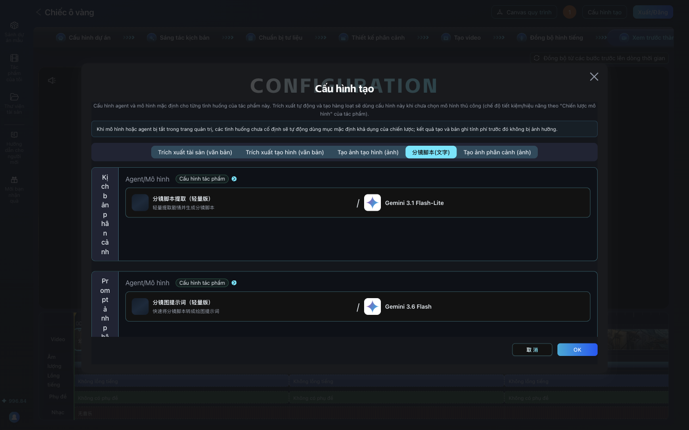

# Lỗi thường gặp và cách xử lý

Mọi lỗi dưới đây đều đã gặp khi chạy thật ngày 2026-10-26 trên AID v2.2.4 bản tiếng Việt.

## Lỗi khi dùng AI miễn phí (Gemini)

| Thông báo / hiện tượng | Nghĩa | Cách xử lý |
|---|---|---|
| "本次生成未完成，稍后重试" | Lần tạo này chưa xong, thử lại sau | Thường do Google quá tải (lỗi 503). Chờ vài giây, bấm lại |
| Bấm lại vẫn lỗi suốt, ở mọi bước có AI | Có thể đã hết 20 lượt/ngày của model (lỗi 429) | Đổi sang model khác trong **Cấu hình tạo**, hoặc chờ sang ngày. Không bị tính tiền |
| Ô chat "AI viết kịch bản" báo "理解请求失败" | Không hiểu được yêu cầu | Bỏ qua ô chat, dán kịch bản tự viết (bài 02) |
| "Tự động tạo phân cảnh" chạy xong nhưng không có cảnh nào | Model nhẹ (Flash-Lite) trả kết quả sai định dạng | Thêm phân cảnh bằng tay (bài 05). Có thể thử Gemini 3.6 Flash, nhưng chưa kiểm chứng |
| AID ghi bối cảnh là buổi sáng (上午) dù kịch bản là buổi tối | AI đọc sai | Sửa trong "Sửa thiết lập bối cảnh", hoặc ghi rõ thời gian khi vẽ ảnh |

**Đổi model cho từng bước:** trong dự án, bấm **Cấu hình tạo** (góc trên phải). Mỗi tab là một loại việc;
bấm vào ô model để chọn **Gemini 3.6 Flash** hoặc **Gemini 3.1 Flash-Lite**, bấm **OK**.

## Lỗi giao diện

| Hiện tượng | Cách xử lý |
|---|---|
| Bấm "Tiếp theo" thấy "该步骤已推进" (bước này đã chuyển rồi) | Bấm thẳng tên bước kế tiếp trên thanh bước |
| Chọn ảnh xong mà phân cảnh vẫn trống | Bấm **Thêm ảnh phân cảnh** trên thanh công cụ của ảnh |
| Tải video xong mà "Tiến độ video" không tăng | Bấm **设置为分镜视频** (đặt làm video phân cảnh) |
| Ô chọn agent báo "Không tìm thấy agent phù hợp" | Ô tìm kiếm có sẵn chữ "Phân cảnh"; bấm dấu x để xóa |

## Lỗi khi xuất phim

| Hiện tượng | Cách xử lý |
|---|---|
| Xuất lỗi, log có "No such filter: 'drawtext'" | Cài `ffmpeg-full`, trỏ AID tới nó (xem `vi/local/README.md`) |
| Phim không có tiếng | Mọi clip phải có rãnh âm thanh trước khi tải lên (`add-voice.sh`) |
| Phụ đề bị đứt giữa chữ | Xóa phụ đề trong AID, in phụ đề bằng `add-subtitles.sh` |
| Phim hiện phụ đề "Lồng tiếng từ máy: ..." | Do đã tải giọng ở bước "Đồng bộ hình tiếng" (AID ghi tên file vào lời thoại của phân cảnh). Xóa nội dung phụ đề ở bước Xem trước chỉ có tác dụng tới lần "Đồng bộ" sau; trong lần chạy thử, phải xóa hẳn lời thoại đó mới hết. Cách chắc chắn: đừng tải giọng ở bước đó |

## Bảng tra nhãn còn chữ Trung

| Chữ Trung | Nghĩa | Gặp ở đâu |
|---|---|---|
| 基本信息 | Thông tin cơ bản | Hộp thoại tạo dự án |
| 剧情演绎 | Diễn kịch (phim có cốt truyện) | Loại kịch bản |
| 真人解说漫 | Truyện tranh có người dẫn | Loại kịch bản |
| 经济模式 / 性能模式 | Chế độ tiết kiệm / hiệu năng | Chiến lược mô hình |
| 图生视频 | Ảnh thành video | Chế độ sáng tác |
| 多参生视频 | Video từ nhiều ảnh tham chiếu | Chế độ sáng tác |
| 专业版 | Bản chuyên nghiệp | Chế độ sáng tác |
| 自动宫格模式 | Chế độ lưới tự động | Chế độ sáng tác |
| 治愈动画 | Hoạt hình chữa lành | Phong cách |
| 场景 / 角色 / 道具 | Bối cảnh / Nhân vật / Đạo cụ | Chuẩn bị tư liệu |
| 初始形象 | Hình ban đầu | Tên tạo hình nhân vật |
| 上午 | Buổi sáng | Tên bối cảnh |
| 分镜脚本提取（轻量版） | Tách kịch bản phân cảnh (bản nhẹ) | Chọn agent |
| 解说分镜脚本提取 | Tách phân cảnh cho phim có lời dẫn | Chọn agent |
| 精简模式 / 标准模式 / 细拆模式 | Gọn / Chuẩn / Chia nhỏ | Mật độ cảnh quay |
| 分镜脚本0N / 分镜视频0N / 分镜配音0N | Kịch bản / video / lồng tiếng phân cảnh N | Tab trên cùng các màn hình chỉnh |
| 设置为分镜视频 | Đặt làm video phân cảnh | Màn hình chỉnh video |
| 取消 | Hủy | Nhiều hộp thoại |
| 预扣约 N 积分 | Tạm giữ khoảng N điểm | Hộp thoại có dùng AI |
| 无音乐 | Không có nhạc | Rãnh nhạc ở bước Xem trước |
